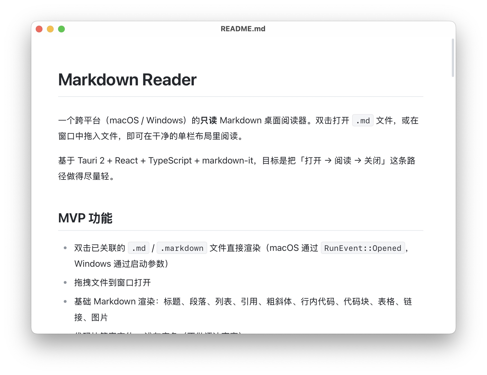

# Markdown Reader

一个跨平台（macOS / Windows）的**只读** Markdown 桌面阅读器。双击打开 `.md` 文件，或在窗口中拖入文件，即可在干净的单栏布局里阅读。

基于 Tauri 2 + React + TypeScript + markdown-it，目标是把「打开 → 阅读 → 关闭」这条路径做得尽量轻。



## MVP 功能

- 双击已关联的 `.md` / `.markdown` 文件直接渲染（macOS 通过 `RunEvent::Opened`，Windows 通过启动参数）
- 拖拽文件到窗口打开
- 基础 Markdown 渲染：标题、段落、列表、引用、粗斜体、行内代码、代码块、表格、链接、图片
- 代码块等宽字体 + 浅灰底色（不做语法高亮）
- 链接交给系统默认浏览器打开，应用窗口不跳转
- 本地图片按 Markdown 文件所在目录解析相对路径；加载失败显示占位提示
- 单栏居中阅读布局，正文最大宽度 760px
- 深浅色跟随系统，无手动切换项
- 记住窗口尺寸和位置
- 标题栏只显示当前文件名

### 不在 MVP 范围

- 编辑、文件树、侧边栏、标签页、应用内搜索
- 导出、插件、Mermaid、语法高亮
- 滚动位置记忆（P1）、KaTeX 数学公式（P1）
- 自动更新、签名与公证

## 技术栈

| 层 | 选型 |
| --- | --- |
| 桌面框架 | Tauri 2（系统 WebView） |
| 前端 | React 19 + TypeScript + Vite |
| Markdown | markdown-it（`html: false`，不执行文档内嵌 HTML/脚本） |
| Rust 侧 | 文件读取、文件关联、窗口状态、asset protocol 作用域、IPC |

## 目录结构

```text
md-reader-app/
├─ src/                       # 前端
│  ├─ components/
│  │  ├─ DropZone.tsx         # Tauri 原生拖拽事件
│  │  ├─ MarkdownView.tsx     # 渲染、链接外跳、图片失败占位
│  │  └─ Notice.tsx
│  ├─ lib/markdown.ts         # markdown-it 配置 + 图片路径解析
│  ├─ styles/global.css       # 阅读排版、浅/深色变量
│  ├─ App.tsx                 # 空态 / 阅读态、IPC 调度
│  └─ main.tsx
├─ src-tauri/
│  ├─ src/
│  │  ├─ lib.rs               # Builder、命令、事件、主题同步
│  │  ├─ file_reader.rs       # 读取 .md，返回内容 + baseDir
│  │  ├─ file_assoc.rs        # 启动参数 / macOS open 事件
│  │  └─ window_state.rs      # 窗口尺寸与位置持久化
│  ├─ capabilities/default.json
│  └─ tauri.conf.json         # 文件关联、CSP、asset protocol
├─ package.json
└─ vite.config.ts
```

## 开发

环境要求：

- Node.js 20+
- Rust stable
- 对应平台的 Tauri 2 系统依赖（macOS 需要 Xcode Command Line Tools）

```bash
npm install
npm run tauri dev
```

开发模式下系统不会注册文件关联，可以把文件拖进窗口测试；也可以通过构建后的应用测试双击打开。

## 构建

```bash
npm run tauri build
```

产物位置：

- macOS：`src-tauri/target/release/bundle/macos/Markdown Reader.app`、`.dmg`
- Windows：`src-tauri/target/release/bundle/msi/*.msi`、`nsis/*.exe`

MVP 阶段未做代码签名 / notarization，系统可能会拦截未签名应用。

## 实现说明

- **文件读取**：`open_file(path)` 返回 `{ path, name, content, baseDir, size }`；只接受 `.md` / `.markdown`，读取失败返回中文错误信息。
- **图片**：Rust 在打开文件时将该文件所在目录加入 asset protocol 的运行时作用域；前端把相对路径改写为 `convertFileSrc(...)`。作用域只覆盖用户显式打开的文件目录，`..` 越界请求会被拒绝。
- **链接**：正文点击事件统一 `preventDefault`，`http(s)` / `mailto` / `tel` 交给 `@tauri-apps/plugin-opener`。
- **主题**：全部颜色由 CSS 变量定义，`prefers-color-scheme` 切换；窗口背景色在 Rust 侧随系统主题同步，减少加载白闪。
- **窗口状态**：移动 / 缩放时防抖写入 `window-state.json`，启动时恢复；位置不在任何屏幕内时只恢复尺寸，避免窗口跑出屏幕。
- **安全**：markdown-it 关闭 `html`；启用 CSP；asset protocol 默认作用域为空，仅按打开的文件目录动态放行。

窗口状态文件位置：

- macOS：`~/Library/Application Support/com.h20.markdown-reader/window-state.json`
- Windows：`%APPDATA%\com.h20.markdown-reader\window-state.json`

## 验证

```bash
npm run build                 # TypeScript + Vite 构建
cd src-tauri && cargo test    # Rust 单元测试
cd src-tauri && cargo clippy
```
